# Supermarket Stock System

Inventory for a supermarket with two roles. An **admin** manages employees, categories and products. An **employee** browses the products and records stock movements: one form, with a Sale or Restock type, for one or more products. Every stock change is kept in a history that explains the current quantities.

**[▶ Live demo](https://full-stack-supermarket-stock-system.vercel.app)**

The demo is private: there are no public accounts, so the link opens the sign-in page and these screenshots show the app. They come from the production build, with fake data.

| Products (admin) | Recording a movement |
| --- | --- |
| 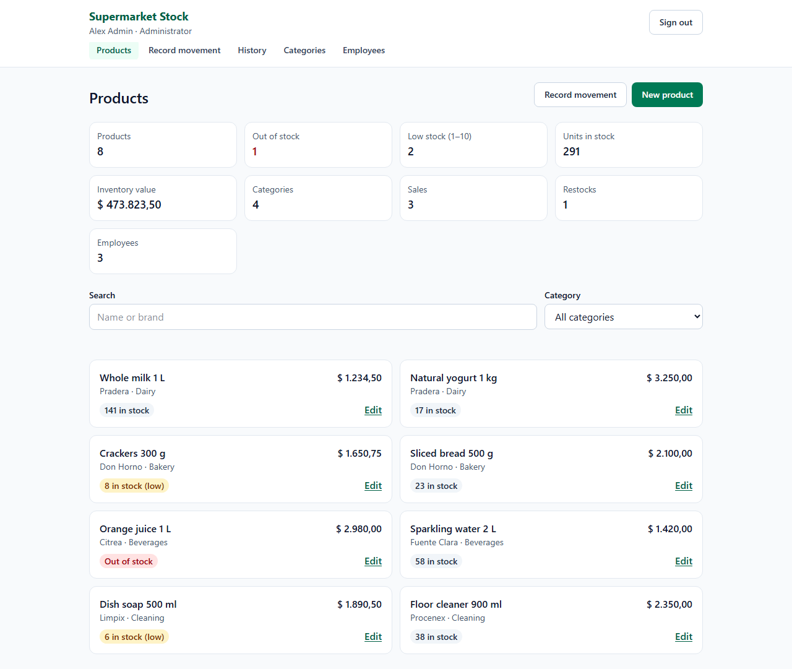 | 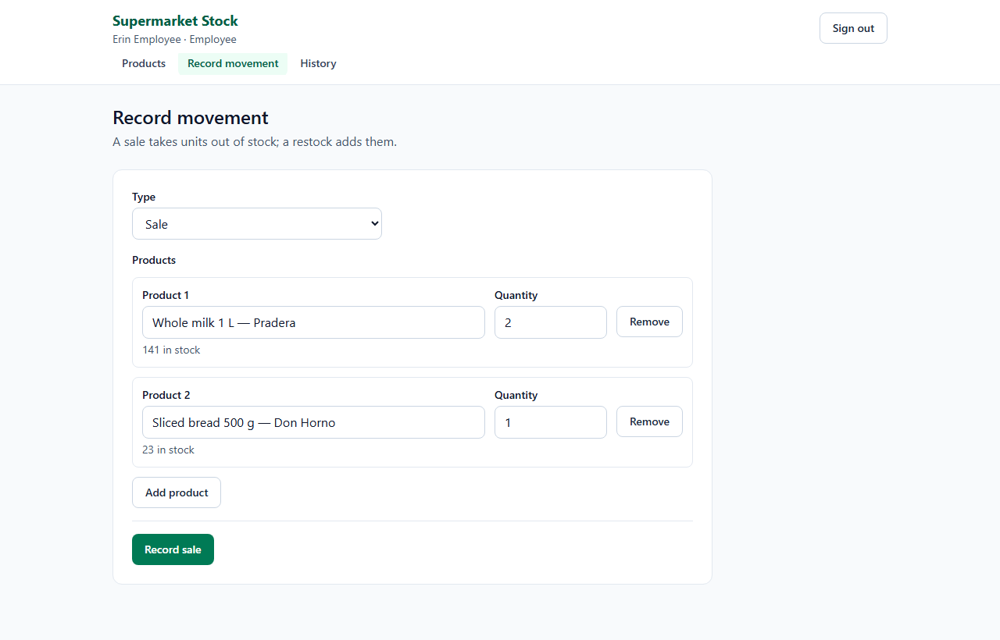 |

| History (admin) | Employees | Categories |
| --- | --- | --- |
| 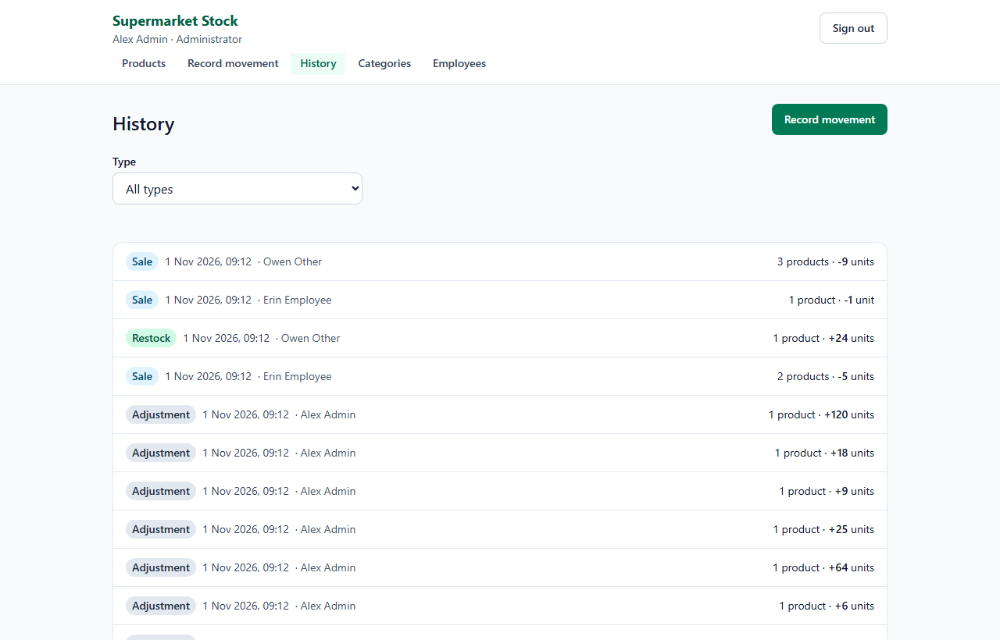 | 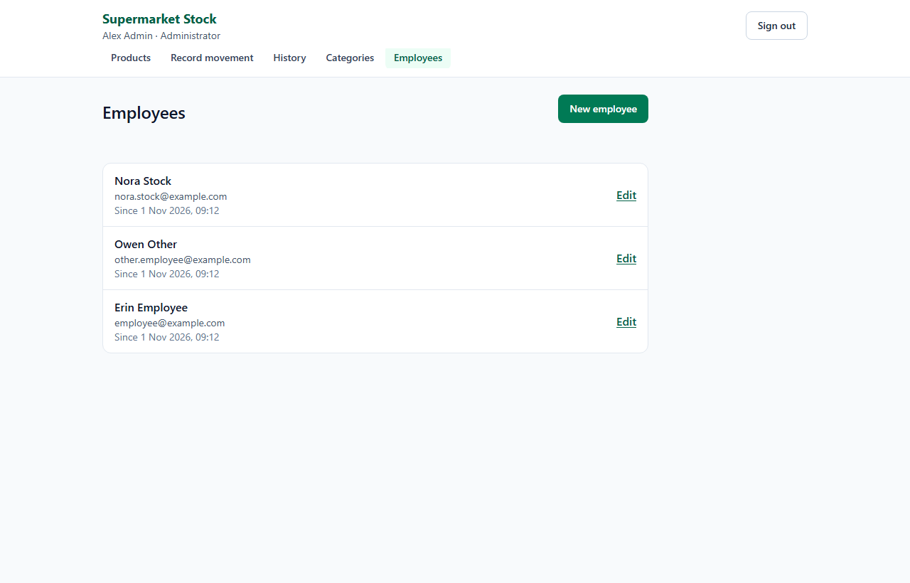 | 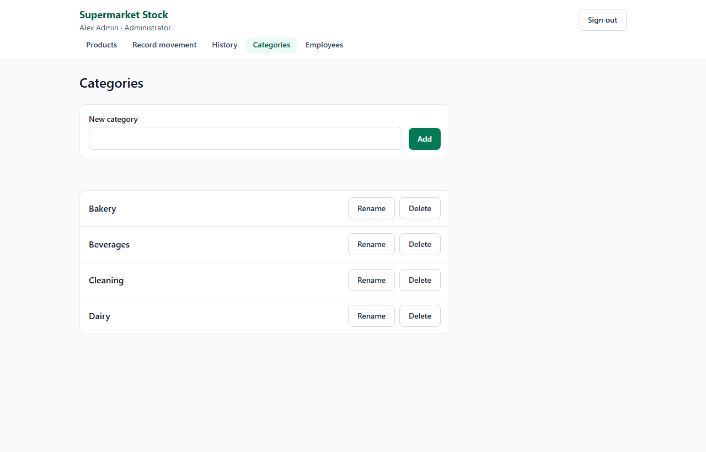 |

| Products on a phone | Movement on a phone | History on a phone |
| --- | --- | --- |
| 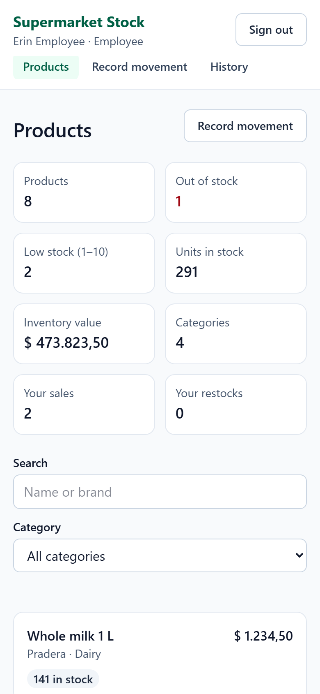 | 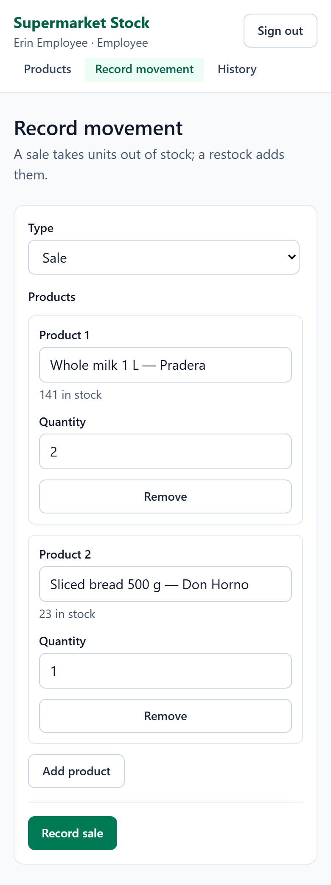 | 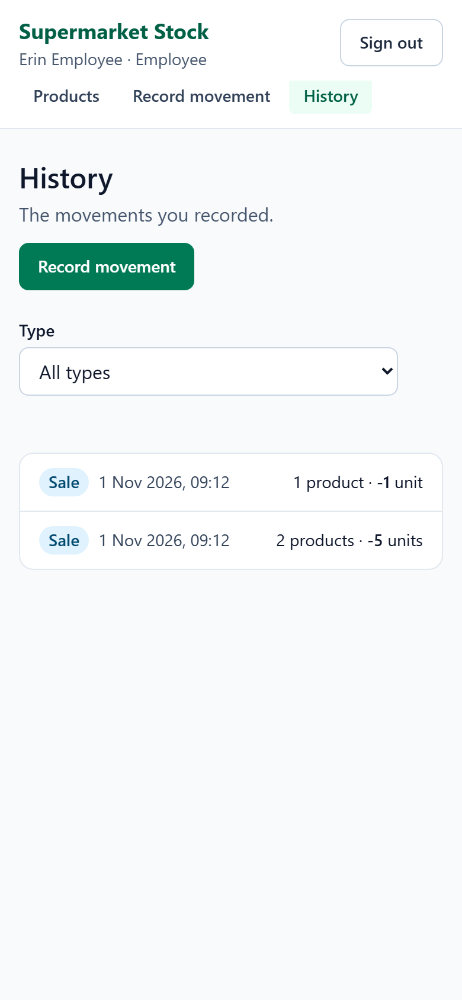 |

## Features

- **Roles:** admins create, edit and delete employees, categories and products. Employees read the catalog and record movements. Admins come only from a command-line tool.
- **Stock movements:** a sale or restock of up to 50 products is applied all or nothing, and every failing line says why. An admin's change to a quantity is recorded as an adjustment.
- **History:** admins see every movement and employees see their own. Lines keep the name, brand and price of the moment, so they survive when a product or an employee is deleted.
- **Catalog:** search by name or brand, filter by category, cursor pagination, and statistics computed in SQL (out of stock, low stock, units, inventory value).
- **Prices in Argentine pesos:** exact decimals everywhere, shown as `$ 1.234,56` and typed as `1234,56` or `1.234,56`.
- **Safe on a bad connection:** writes retry on their own, keep going while the user visits other screens, and never apply twice. Two admins editing one product cannot overwrite each other, or a sale, by accident.
- **Accessible and mobile first:** a keyboard-usable product picker, errors connected to their fields for screen readers, and layouts that work at phone width.

## Stack

| Layer | Technology |
| --- | --- |
| Runtime | Node.js 26, npm workspaces, TypeScript 7 |
| Backend | Express 5, Zod 4, `pg`, helmet, cors, express-rate-limit |
| Database | PostgreSQL 18: Neon in production, PGlite in development and tests |
| Frontend | React 19, Vite 8, React Router 8, Zustand 5, Tailwind CSS 4 |
| Tests | Node Test Runner, Playwright (Chromium) |
| Hosting | Vercel: a static frontend plus the API as one Vercel Function |

## Architecture

Production:

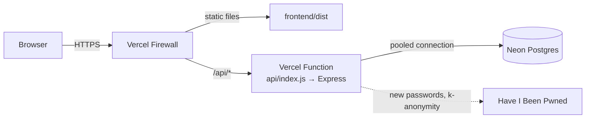

Local development:

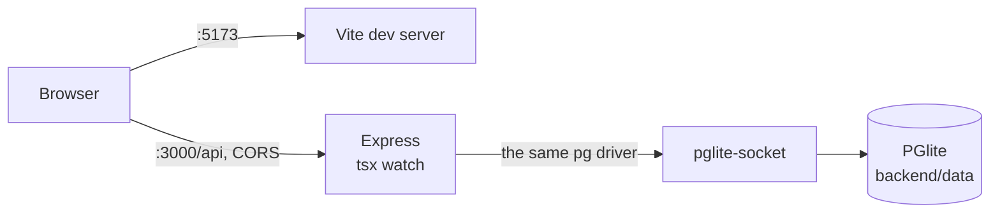

The backend follows the **MVC (Model-View-Controller) architectural pattern**, where the view is the JSON response:

- **routes** connect validation to controllers;
- **controllers** are thin;
- **models** are the only layer that knows SQL, always parameterized, and they validate their rows;
- **Zod schemas** are the single source of truth for validation and types.

`createApp` never listens on a port, so the long-running server (`index.ts`) and the serverless entry (`vercel.ts`) share it.

In the frontend, every page is loaded lazily, and Zustand stores built from factories hold the data and the writes. Pure logic such as money, numbers, dates and form validation lives in `lib/`, tested without a browser.

## Project structure

```text
├─ api/index.js            # the Vercel Function: re-exports the compiled backend
├─ backend/
│  ├─ src/
│  │  ├─ routes/ controllers/ models/ schemas/   # the MVC layers
│  │  ├─ middlewares/      # auth, rate limits, validation, errors
│  │  ├─ db/               # pool, schema, PGlite
│  │  ├─ lib/              # passwords, sessions, pagination, routing
│  │  ├─ cli/create-admin.ts
│  │  ├─ index.ts          # long-running entry
│  │  └─ vercel.ts         # serverless entry
│  └─ tests/               # Node Test Runner, and the API server for the e2e tests
├─ frontend/
│  ├─ src/
│  │  ├─ api/              # HTTP client, types, limits
│  │  ├─ stores/           # Zustand store factories
│  │  ├─ pages/ components/ hooks/
│  │  └─ lib/              # pure logic
│  └─ tests/               # unit/ (Node Test Runner) and e2e/ (Playwright)
├─ scripts/                # dependency policy checks, password blocklist generator
├─ docs/screenshots/
├─ CLAUDE.md               # working agreement and architecture notes for the AI agent
├─ SECURITY.md             # how to report a vulnerability privately
└─ vercel.json             # build, rewrites, security headers, cache
```

## Getting started

You need Node.js 26 (`.nvmrc` pins the version; `fnm use` picks it up) and npm 11. Local development needs no database server and no accounts.

```powershell
npm ci

# Create the first admin in the local database (it prompts for the details)
npm run create-admin -w backend

# In two terminals
npm run dev -w backend     # API on http://localhost:3000
npm run dev -w frontend    # app on http://localhost:5173
```

Stop `npm run dev -w backend` before running `create-admin` again: a PGlite data directory can be open in only one process at a time.

### Environment variables

All of them are optional locally. Copy `backend/.env.example` to `backend/.env` to change one; an empty value counts as not set.

| Variable | Default | Purpose |
| --- | --- | --- |
| `NODE_ENV` | `development` | `production` requires `DATABASE_URL` |
| `PORT` | `3000` | API port for the long-running server |
| `DATABASE_URL` | (empty) | Postgres connection string. Empty uses PGlite. **A secret**: a Sensitive variable in Vercel |
| `PGLITE_DATA_DIR` | `./data` in development | PGlite data directory; memory outside development |
| `CORS_ORIGINS` | `http://localhost:5173` | Comma-separated exact origins |
| `SESSION_TTL_HOURS` | `12` | Absolute session lifetime |
| `RATE_LIMIT_WINDOW_MS` | `60000` | Window of the read and write limits |
| `RATE_LIMIT_READ_MAX` | `300` | Reads per IP per window |
| `RATE_LIMIT_WRITE_MAX` | `60` | Writes per IP per window |
| `RATE_LIMIT_LOGIN_WINDOW_MS` | `900000` | Window of the failed-login limits |
| `RATE_LIMIT_LOGIN_MAX` | `10` | Failed logins per IP per window |
| `RATE_LIMIT_LOGIN_ACCOUNT_MAX` | `100` | Failed logins per account per window |
| `PWNED_PASSWORDS_URL` | `https://api.pwnedpasswords.com` | Have I Been Pwned range API |

The frontend has one public variable, `VITE_API_URL`, versioned in `frontend/.env.development` and `frontend/.env.production`. Never put a secret in a `VITE_*` variable: it ends up in the public JavaScript.

### Scripts

| Command | What it does |
| --- | --- |
| `npm run dev -w backend` | API on :3000 with reload, PGlite persisted in `backend/data` |
| `npm run dev -w frontend` | Vite on :5173 |
| `npm run build` | Compiles the backend and builds the frontend (one chunk per page) |
| `npm run preview -w frontend` | The production build on :4173, with the `vercel.json` headers |
| `npm run typecheck` | Both workspaces |
| `npm test` | Scripts, backend, frontend unit tests and e2e against the dev servers |
| `npm run test:coverage` | Backend coverage with thresholds (97 % lines, 93 % branches, 93 % functions) |
| `npm run test:concurrency -w backend` | Overlapping requests on a real Postgres: the `DATABASE_URL` in `backend/.env.concurrency.local`, a Neon branch created with "Schema only". It changes that database freely and refuses one that has users |
| `npm run test:e2e:prod -w frontend` | The same e2e specs against the production build |
| `npm run test:e2e:remote -w frontend` | Read-only smoke test against a deployment |
| `npm run create-admin -w backend` | Creates an admin (`-- --env <file>` targets the `DATABASE_URL` in that file) |
| `npm run check:versions` | Exact versions, lockfile and `.npmrc` policy |
| `npm run check:release-age` | Every locked package is at least 14 days old (network) |
| `npm run audit` | `npm audit` for production dependencies |

## API reference

The API lives under `/api` and speaks JSON only. A signed-in session is a cookie. A request with a body must be `application/json`, at most 10 kb and not compressed.

| Method and path | Who | Notes |
| --- | --- | --- |
| `GET /health` | public | Does not touch the database; outside the rate limits |
| `POST /auth/login` | public | `{ email, password }`; sets the session cookie |
| `POST /auth/logout` | public | Always 204 |
| `GET /auth/session` | public | Always 200: `{ user }` or `{ user: null }` |
| `GET /categories`, `GET /categories/:id` | signed in | |
| `POST /categories`, `PATCH /categories/:id`, `DELETE /categories/:id` | admin | Names are unique ignoring case |
| `GET /products`, `GET /products/:id` | signed in | `?q=` searches name and brand; `?categoryId=` filters |
| `POST /products`, `PATCH /products/:id`, `DELETE /products/:id` | admin | A PATCH must send the current `version` |
| `GET /stats` | signed in | One SQL round trip; employees count only their own movements |
| `GET /stock-movements`, `GET /stock-movements/:id` | signed in | Admins see all; employees see their own. `?type=` filters |
| `POST /stock-movements` | signed in | `{ id, type: "sale" \| "restock", items: [{ productId, quantity }] }` |
| `GET /employees`, `GET /employees/:id` | admin | |
| `POST /employees`, `PATCH /employees/:id`, `DELETE /employees/:id` | admin | A new password signs the employee out everywhere |

Stock movements are never edited or deleted.

- **Money:** `price` is a decimal string (`"1234.56"`), never a JSON number.
- **Dates:** ISO 8601 in UTC.
- **Idempotent creates:** the client generates the UUID `id`. Repeating the same create returns the stored resource with **200**; the same id with different data answers 409 `ALREADY_EXISTS`.

### Pagination

Lists use keyset pagination on `(created_at DESC, id DESC)`: `?limit=` (default 20, maximum 100) and `?before=<id>`. The body is a plain array, and the next page comes in a `Link: <...>; rel="next"` header. A cursor that is not a row of the list answers 400 on `before`.

### Errors

Every error has one shape: `{ "error": { "code", "message", "details": [{ "path", "message" }] } }`.

| Status | Codes | When |
| --- | --- | --- |
| 400 | `VALIDATION_ERROR`, `INVALID_JSON`, `BAD_REQUEST` | The request is not valid; `details` points at each field |
| 401 | `UNAUTHENTICATED`, `INVALID_CREDENTIALS` | No valid session; wrong email or password |
| 403 | `FORBIDDEN` | The role cannot use this route |
| 404 | `ROUTE_NOT_FOUND`, `CATEGORY_NOT_FOUND`, `PRODUCT_NOT_FOUND`, `EMPLOYEE_NOT_FOUND`, `STOCK_MOVEMENT_NOT_FOUND` | Does not exist, or belongs to another employee |
| 405 | `METHOD_NOT_ALLOWED` | With an `Allow` header |
| 409 | `ALREADY_EXISTS`, `EMAIL_TAKEN`, `CATEGORY_NAME_TAKEN`, `CATEGORY_IN_USE`, `PRODUCT_VERSION_CONFLICT`, `INSUFFICIENT_STOCK`, `STOCK_LIMIT_EXCEEDED` | Conflicts with the stored data |
| 413 | `PAYLOAD_TOO_LARGE` | The body is over 10 kb |
| 415 | `UNSUPPORTED_MEDIA_TYPE` | The body is not uncompressed UTF-8 JSON |
| 429 | `RATE_LIMITED` | With `RateLimit` headers |
| 500 | `INTERNAL_ERROR` | Generic; the details go only to the log |
| 503 | `SERVICE_UNAVAILABLE`, `SERVER_MISCONFIGURED` | The database is unavailable, or the configuration is invalid; with `Retry-After` |

### Rate limits

| What | Limit | Counted |
| --- | --- | --- |
| Reads | 300 per minute per IP | In memory, per function instance |
| Writes | 60 per minute per IP | In Postgres, shared by every instance |
| Failed logins | 10 per 15 minutes per IP, and 100 per account | In Postgres; successful logins do not count |
| Everything under `/api/` | 100 per minute per IP | Vercel Firewall, in production |

The counters are keyed by SHA-256 hashes, so they hold no raw IP or email.

## Database schema

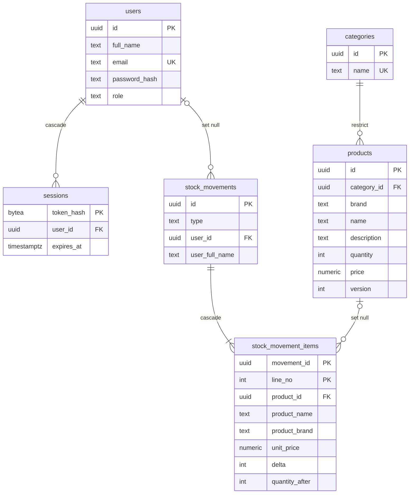

Two more tables stand alone: `rate_limits` (counters) and `schema_version` (the hash of the schema statements).

- Tables have `created_at`, and users, categories and products have `updated_at`, kept by triggers. A trigger also bumps `products.version` on every update, whoever writes it.
- Named CHECK constraints back up the validation (`quantity` from 0 to 1,000,000, `price` not negative).
- The schema is created on the first request that needs it, in one transaction under an advisory lock, and only when its statements changed.

## Deployment (Vercel + Neon)

1. **GitHub.** Push the repository. In its security settings, turn on Secret Protection, Push protection, Dependabot alerts and Private vulnerability reporting.
2. **Neon.** Create a project with **Postgres 18**, the same major version as PGlite, in the region closest to the Vercel functions (AWS `us-east-1` by default). Copy the **pooled** connection string (the host contains `-pooler`) and change `sslmode=require` to `sslmode=verify-full`, which keeps the full certificate check when a future `pg` major version gives `require` its weaker libpq meaning.
3. **Vercel.**
   - Import the repository, giving Vercel access to this repository only.
   - Choose the Application Preset **Other** and leave the build commands alone; `vercel.json` sets them. Ignore the suggestion to deploy `./backend` and `./frontend` separately.
   - Add `DATABASE_URL` as a **Sensitive** variable for **Production and Preview**. The value is only the URL, starting with `postgresql://`, with no variable name and no quotes; anything else answers 503 `SERVER_MISCONFIGURED`. Preview deployments use this same database unless you give them their own Neon branch.
   - Deploy. Variables reach only new deployments, so redeploy after changing one.
4. **First admin.** Put `DATABASE_URL=<connection string>` in `backend/.env.production.local` (gitignored), then run:
   ```powershell
   npm run create-admin -w backend -- --env .env.production.local
   ```
5. **Firewall.** In Vercel's Firewall, add one Rate Limit rule: if `Request Path` starts with `/api/`, fixed window of 60 s, 100 requests per **IP** (only IP), action "Too many requests (429)".
6. **Verify.** Don't send bursts of requests to test the limit: Vercel's automatic protection challenges the IP that does it.
   ```powershell
   curl.exe -I https://<your-app>.vercel.app/
   curl.exe https://<your-app>.vercel.app/api/health
   curl.exe -I https://<your-app>.vercel.app/assets/does-not-exist.js   # must be 404
   # The password is typed at a hidden prompt, so it stays out of the shell history.
   $secret = Read-Host "Admin password" -AsSecureString
   $env:E2E_PASSWORD = [pscredential]::new("admin", $secret).GetNetworkCredential().Password
   $env:E2E_BASE_URL = "https://<your-app>.vercel.app"; $env:E2E_EMAIL = "<admin email>"
   npm run test:e2e:remote -w frontend
   Remove-Item Env:E2E_PASSWORD, Env:E2E_EMAIL, Env:E2E_BASE_URL; Remove-Variable secret
   ```

## Security

- **Sessions:** a 32-byte random token in an `httpOnly`, `SameSite=Strict` cookie (`__Host-` and `Secure` in production), with a 12-hour absolute lifetime. The database stores only its SHA-256. Each login issues a new token, and a new password ends the employee's sessions.
- **Passwords (NIST SP 800-63B):** 15 to 128 characters with no composition rules, hashed with scrypt using OWASP parameters. New passwords must pass a bundled list of common passwords, checks for repeats, sequences and personal data, and Have I Been Pwned (only 5 characters of the SHA-1 are sent). If that service is unreachable, the check is skipped and logged.
- **Login:** the same answer and the same cost for an unknown email and a wrong password.
- **Authorization:** the role is read from the database on every request. A route the role cannot use answers 403 before any lookup; another employee's movement answers 404.
- **Requests:** JSON only, up to 10 kb, strict schemas that reject unknown fields, parameterized SQL, and an exact CORS origin list.
- **Headers:** helmet on the API; a strict CSP, HSTS, `nosniff`, `frame-ancestors 'none'`, a restrictive `Permissions-Policy` and `Referrer-Policy: no-referrer` on the site.
- **Secrets:** only in the gitignored `backend/.env` and in Vercel Sensitive variables. Test credentials are obviously fake.

To report a vulnerability, follow [SECURITY.md](SECURITY.md). Please report it privately.

## Operation

- **Logs:** one JSON line per event, with the method, path and status; never IPs, query strings, bodies or secrets.
- **Availability:** `GET /api/health` answers without waking the database. An unreachable database gives a 503 JSON with `Retry-After`, and a request retries the schema step if an earlier one failed.
- **Timeouts:** each connection and query is limited below the function's 10-second maximum. Transactions also have limits on the server, which release their row locks even if the function is cut off.
- **Cleanups:** expired sessions and rate-limit rows are deleted in the background, without making a request wait.

## Reproducible installs

- `.npmrc` sets `min-release-age=14`, `save-exact=true` and `engine-strict=true`: dependencies are at least 14 days old, with exact versions, and always installed with `npm ci`.
- `npm run check:versions` and `npm run check:release-age` enforce that policy against the lockfile. The one current exception is a security fix for a dependency of Express, `body-parser@2.4.0`.
- Only approved packages can run install scripts (`allowScripts`): just `esbuild`, pinned by version.
- Dependabot groups the packages that must be upgraded together and respects the same 14-day window.

## Known limitations

Deliberate scope decisions, what bounds each one, and the next step if it ever matters:

| Limitation | Why it is acceptable | Next step |
| --- | --- | --- |
| Admins cannot change their own password or name in the app | Few accounts, created by whoever runs the command-line tool | A profile screen |
| A schema change applied during sales can deadlock with one of them | Only when a deployment changes the schema; that sale rolls back, answers 503 and the app retries it with the same id | Versioned migrations |
| No "forgot my password" email | An admin sets a new password for an employee | Email reset links |
| The schema has no migrations: its statements only create what is missing | Enough while tables only gain new objects. A deployment that changes them runs them on the first request, holding writes for a moment | A migration tool, run at deploy time |
| `/stats` counts the movement history on every visit for admins | About 60 ms at 200,000 movements, measured on an in-memory database; it will be slower on Neon | Counter tables updated in the movement's transaction |
| The CSP allows inline styles (`style-src 'unsafe-inline'`) | No inline scripts are allowed, and the app renders no user-supplied HTML | Style nonces, if the stack supports them |
| One currency (ARS) and one language (English) | The scope of this project | Configurable formats and translations |

## How this was built

I built this project with [Claude Code](https://claude.com/claude-code), an AI coding agent, working under my direction. Commits made with the agent carry a `Co-Authored-By` trailer, which is why it appears under Contributors.

**My role: product, architecture decisions and review.** I wrote the original specification, set the bar and reviewed the work. I also set up the infrastructure myself: the Neon database, the Vercel deployment with its environment variables and Firewall rule, and the GitHub security settings.

- Key decisions I made:
  - **The MVC (Model-View-Controller) architectural pattern**, applied strictly, so only the models know SQL.
  - **Server-side sessions in Postgres**, so a session can be revoked at once.
  - **Keyset pagination**, so pages stay fast and stable while rows are being added.
  - **Idempotent writes resolved on the server**, so a retry after a lost response is always safe.
  - **Lazy loading per page**, to keep the first load small.
  - **A 14-day window for dependencies**, as protection against supply-chain attacks.
  - **Admins created only from a command-line tool**, so no public screen can create one.
  - **A movement history with adjustments**, so the history always explains the stock.
- The quality and security bar:
  - tests at three levels (backend, frontend units and end to end, also against the production build), with coverage thresholds;
  - no secret in the repository, and every vulnerability found is fixed before the code is published;
  - a review of the whole code before the first deployment.
- I asked for a plan before every change, reviewed it and asked why decisions were made.

**The agent's role: implementation and verification.**

- It researched current versions and documentation.
- It implemented the approved plans.
- It ran the agreed verification: typecheck, audits and the affected tests before each commit, and the full suite when each stage closed.
- It looked for the root cause of intermittent tests instead of retrying or skipping them.

`CLAUDE.md` holds the working agreement and the architecture notes it follows.

**The workflow.**

1. I describe what I want.
2. The agent proposes a plan, and nothing is coded until I approve it.
3. It implements and verifies, and I review.
4. It prepares the commit, I push it myself, and Vercel deploys from GitHub.

## License

[MIT](LICENSE)
